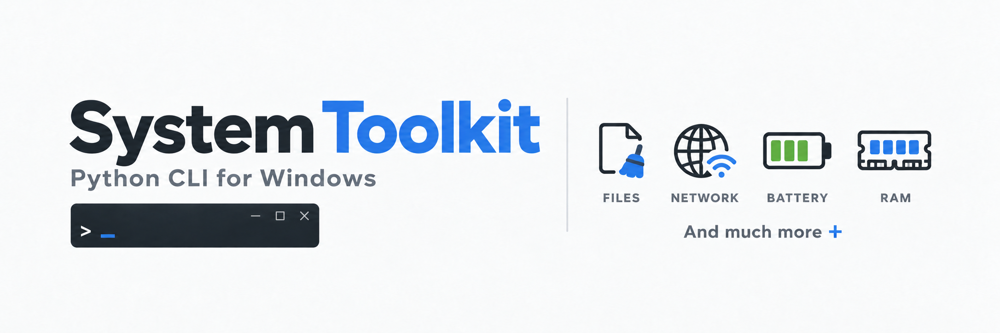

# System Toolkit



A Python command-line toolkit for Windows cleanup, networking, battery, memory, and hardware details.

## 🧰 Tools

- 🧹 **File cleanup:** Scan a folder or known junk and temporary-file locations, preview results, and confirm cleanup.
- 🌐 **Network:** Inspect adapters, refresh the DNS cache, change IPv4 DNS providers, and restore previous settings.
- 🔋 **Battery:** Check battery status, activate an installed Power Saver plan, and restore the original plan.
- 🧠 **RAM:** View memory usage and request eligible user applications to close.
- 🖥️ **PC Parts & Health:** View CPU, RAM type and capacity, GPU, storage, and motherboard details.

### ✨ What's New

**PC Parts & Health** adds a refreshable hardware summary, supported CPU/GPU temperatures in °C, and disk health reported by Windows. Unavailable readings show `N/A` or `Unknown`.

NVIDIA temperatures use [nvidia-ml-py](https://pypi.org/project/nvidia-ml-py/) and the installed graphics driver. CPU and other GPU temperatures can use [Libre Hardware Monitor](https://github.com/LibreHardwareMonitor/LibreHardwareMonitor): under **Options > Remote Web Server**, set **Interface / Port** to `127.0.0.1:8085`, then enable **Run**. Keep it open and refresh the tool. Sensor access may require administrator approval; unsupported readings remain `N/A`. Older WMI providers are also supported.

## 🚀 Quick start

Requires Windows 10/11, Python 3.11+, and Windows PowerShell 5.1.

Run from the project folder in PowerShell:

```powershell
python -m venv .venv
.\.venv\Scripts\python.exe -m pip install -r requirements.txt
.\.venv\Scripts\python.exe main.py
```

## 🧭 Usage

Choose a menu number. Use `0` to go back or cancel. Choose `5` for PC Parts & Health and `6` to exit the main menu.

For a computer-wide cleanup scan, choose **Clean up files > 3**. It checks known locations on local fixed drives and includes subfolders within the scan limits. Temporary files must be at least 24 hours old; crash reports must be at least 7 days old.

Review the preview and answer `yes` to move all displayed files to the Recycle Bin, or `no` to cancel. Save your work before closing an application.

## 🔐 Permissions

Start the app normally. Protected DNS actions open the Windows administrator approval prompt. Approve to continue the selected action in an administrator window; cancel to stay in normal mode. The same settings backups are kept. Access to Windows Temp, other users' folders, and power-plan changes depends on device permissions.

## 💾 Settings and recovery

Backups and logs are stored in `%LOCALAPPDATA%\SystemToolkit`. Restore DNS and power settings from their tool menus. Use one Toolkit window at a time.

## 📁 Project structure

```text
main.py              Entry point
toolkit/             Tools and shared helpers
assets/              Project banner
requirements.txt     Dependencies
```
